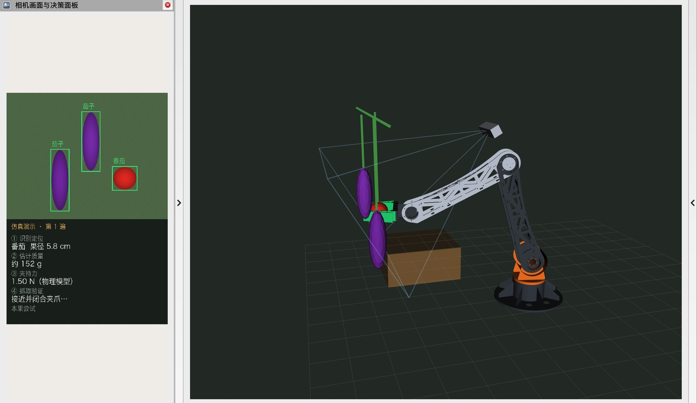
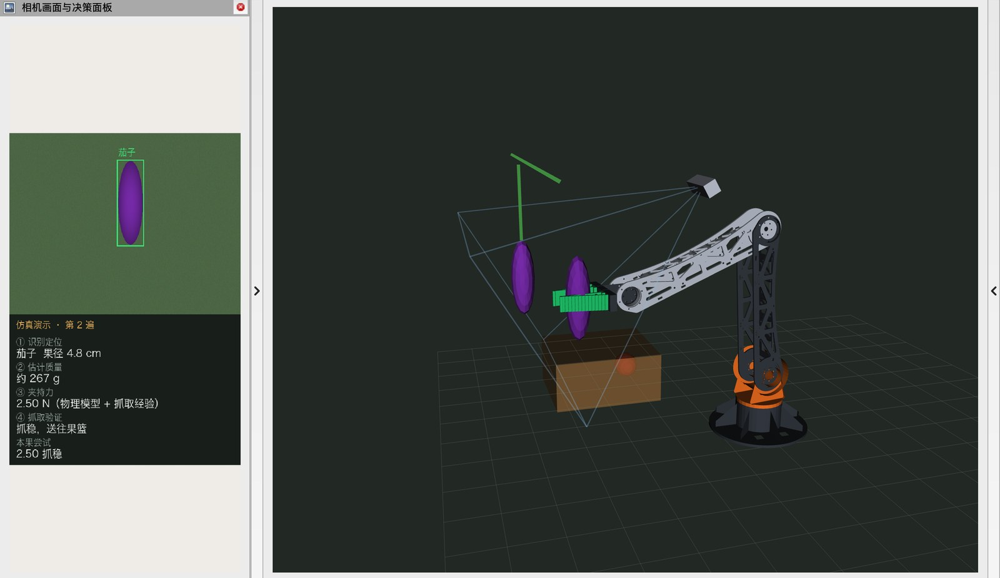
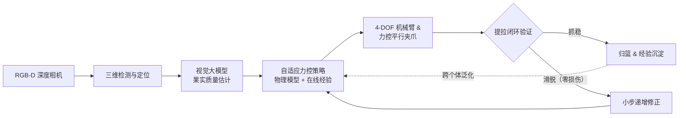

# 智汇蔬香 · 自适应力控采摘机械臂子系统

果蔬采摘自动化的核心瓶颈不在视觉定位，而在**无损且可靠的夹持力控制**：夹持力过大会导致果肉压伤、损耗商品价值；过小则在提拉时滑脱。传统方案依赖针对单一品类、特定成熟度的人工调参，难以适应果蔬个体差异与跨品种作业。

作为**智汇蔬香**智能农业体系的核心作业执行模块，本采摘机械臂子系统将视觉大模型先验、物理力学模型与在线经验学习相结合，使机械臂能够**基于单目/深度视觉估计果实质量与几何特征，自主决策最小安全夹持力，并在作业中持续自校准**。

---

## 核心优势与商业价值

| 痛点 | 传统采摘方案 | 本系统方案 |
|---|---|---|
| **果品损伤率** | 固定力或粗略分档，易压伤高价值软果 | **非对称安全策略（宁轻勿重）**：从理论最小力起步，严格受限于防压伤阈值 |
| **跨品种迁移** | 换品种/换茬需工程师到场重新标定调参 | **零样本启动 + 在线自校准**：新场景仅需前几次抓取即可完成摩擦与形心补偿学习 |
| **硬件成本** | 依赖昂贵的多维力/触觉阵列传感器 | **算法替代高价传感**：深度相机 + 低成本电流/位置闭环平行夹爪即可实现精准力控 |
| **系统可解释性** | 端到端黑盒模型，失效难以排查 | **物理模型兜底 + 经验修正**：边界清晰、安全可控，满足农业机械量产可靠性要求 |

---

## 闭环采摘演示（数字孪生仿真）

场景中包含 1 个番茄与 2 根茄子。系统自动完成：**RGB-D 识别定位 → 视觉估重 → 夹持力决策 → 抓取与滑脱验证 → 归篮与经验更新**。

**① 视觉定位、质量估计与初始力决策**  
左侧为相机实时画面与决策面板，右侧为 4-DOF 机械臂三维数字孪生状态。



**② 非对称安全试探（首次遇到细长偏心茄子）**  
首次按物理下限施力（1.75 N），提拉检测发现滑脱——**果实仍挂在枝上且零损伤**，系统自动记录负样本并按安全步长小幅加力。


**③ 在线修正并稳固抓起**  
上调至最小安全有效力（2.50 N）后成功抓稳归篮，并将该品种的形心/摩擦修正量写入经验库。


**④ 经验复用：后续同品类采摘一次成功**  
第二轮面对不同尺寸的茄子，系统直接调用首轮习得的经验修正物理模型，**无需试探、一次抓稳**。



---

## 技术架构



1. **三维感知与定位**：结合色彩/深度学习检测与点云反投影，输出底座坐标系下的三维中心、果径及工作空间可达性校验。
2. **视觉质量估计**：发挥视觉大模型对语义与尺寸先验的优势，看图估算果实质量，并在异常时平滑退回几何体积-密度先验。
3. **物理 + 经验混合力控**：以库仑摩擦与防压伤上限构建安全边界，通过在线抓取反馈修正异形果蔬的偏心矩与表面摩擦差异。
4. **可插拔工程架构**：感知、估重、力控策略与硬件驱动全部模块化抽象（详见 [`force_policy.py`](zhihui_picker/zhihui_picker/force_policy.py)、[`plugins.py`](zhihui_picker/zhihui_picker/plugins.py)），支持仿真与实机无缝切换。

---

## 工程进展与路线图

- [x] **核心软件栈与仿真验证**：4-DOF 正逆运动学、最小加加速度（Minimum-Jerk）轨迹规划、重力前馈、全流程闭环仿真与自动化测试套件（24 项单元与集成测试全通过）。
- [ ] **实机集成联调（进行中）**：基于嵌入式主控 + RealSense 深度相机 + 力控平行夹爪的低成本量产原型机联调。
- [ ] **大棚实地测试与品类扩展**：面向番茄、茄子、彩椒等主流温室果蔬开展田间采收率与无损率验证，集成末端果柄剪切机构。

---

## 快速体验（面向技术评估）

环境要求：ROS 2 Humble，Python 3.10+，`numpy`、`scipy`、`pyyaml`（可视化中文面板可选安装 `pillow`）。

```bash
# 编译并启动 ROS 2 + RViz 三维数字孪生演示
colcon build && source install/setup.bash
ros2 launch zhihui_picker picker.launch.py
```

```bash
# 无 ROS 环境下的纯命令行快速仿真与测试
PYTHONPATH=zhihui_picker python3 -m zhihui_picker.cli demo --fast
PYTHONPATH=zhihui_picker pytest zhihui_picker/test/test_framework.py
```

---

## 许可与联系

本项目采用 [Apache-2.0 License](LICENSE) 许可协议。  
商务合作、投资垂询与技术交流：[cyg@cyg.world](mailto:cyg@cyg.world)
